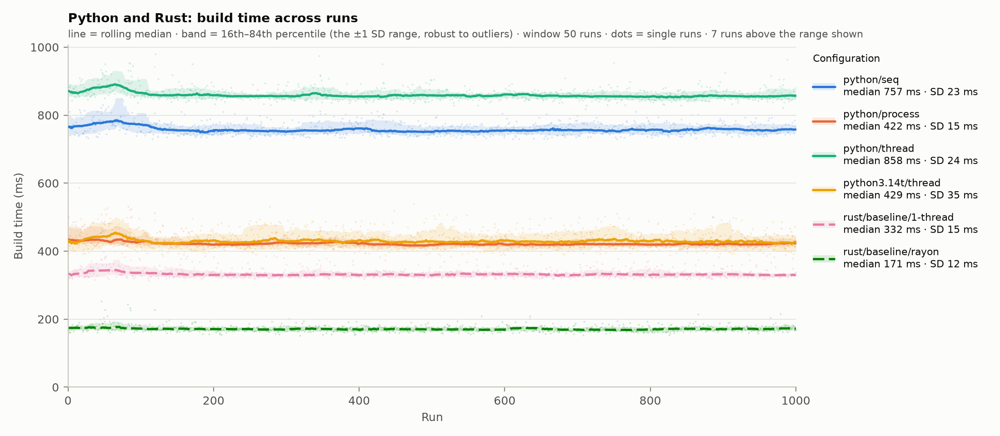
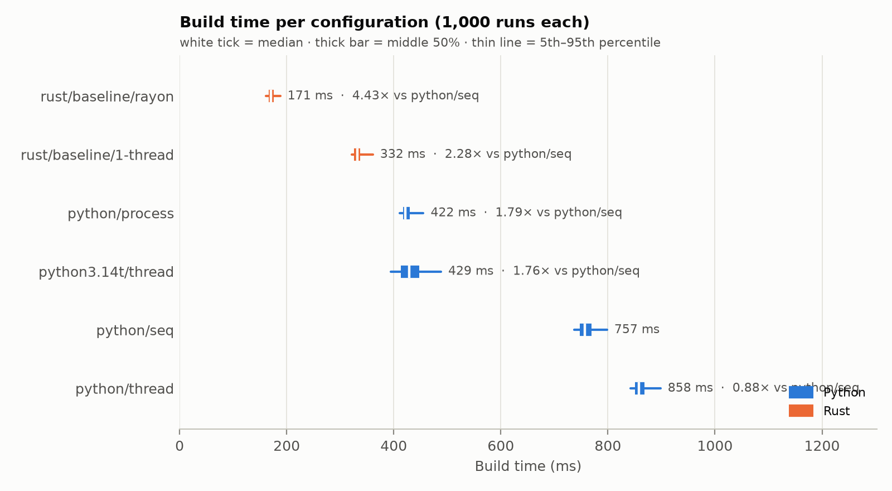
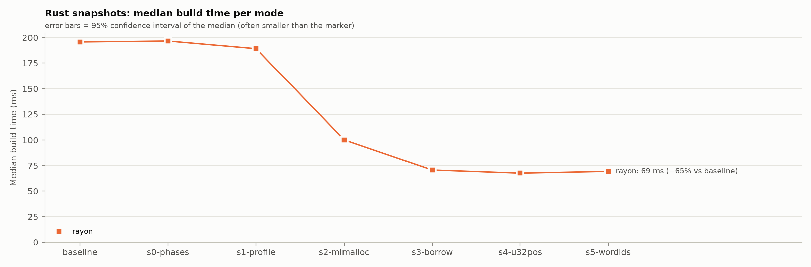
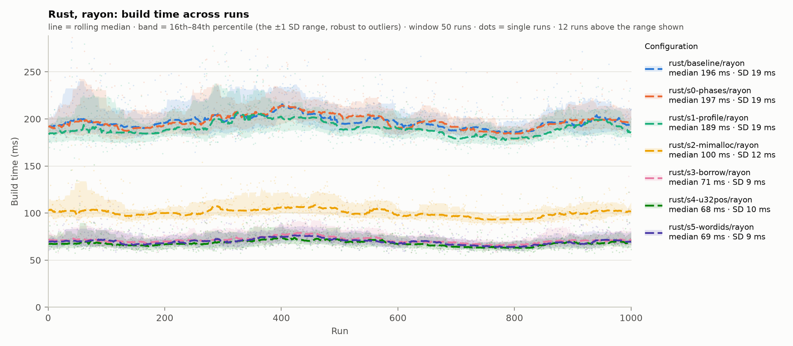

# rust-playground

A sandbox for learning Rust. Everything builds and runs inside a dev container, so no Rust
toolchain is installed on the Windows host. Code is edited in PyCharm Professional, with the Rust
plugin, connected to the container as a remote backend.

## What's here

| Path | What it is |
|---|---|
| `src/main.rs` | The current exercise: a small BM25 search engine over a folder of `.txt` files |
| `Cargo.toml` | The crate, `playground`. Dependencies: `rayon` (parallel indexing) and `mimalloc` (memory allocator). The release profile uses fat LTO and one codegen unit |
| `.cargo/config.toml` | Builds for this machine's CPU (`target-cpu=native`) |
| `bench/` | Benchmarks: Python against Rust, and the Rust tuning series. See [Benchmarks](#benchmarks) |
| `rust-toolchain.toml` | Pins Rust 1.99.0, with clippy and rustfmt |
| `.devcontainer/` | The container: `Dockerfile` and `devcontainer.json` |
| `data/` | Sample texts for the search exercise. Not committed; see [Sample data](#sample-data) |

## The container

- **Image:** `rust:1.99-slim-trixie` (Debian 13), plus git, gdb and the libraries the JetBrains
  backend needs.
- **User:** `dev`, not root.
- **Build output and downloaded crates** live in two named Docker volumes:
  - `rust-playground-target`, at `/home/dev/target` (set by `CARGO_TARGET_DIR`);
  - `rust-playground-registry`, at `/usr/local/cargo/registry`.

  Builds stay fast, they survive a container rebuild, and nothing compiled lands in the Windows
  folder.
- **Sources** are mounted from Windows at `/IdeaProjects/rust-playground`. The container and
  Windows see the same files, so git works from Windows with the container off.

To change the Rust version, change it in both the `Dockerfile` and `rust-toolchain.toml`.

## Getting started

You need Docker Desktop running, and PyCharm Professional with the Rust plugin.

**First time:**

1. Open `.devcontainer/devcontainer.json` in PyCharm.
2. Click the container icon in the gutter and choose **Create Dev Container and Mount Sources**.
3. When asked, choose the PyCharm 2026.2 backend.

**After that:** go to **File → Remote Development → Dev Containers**, pick `rust-playground` and
connect.

The terminal in the remote IDE is a shell inside the container. Check it with:

```bash
cargo --version
```

## Sample data

`data/` is in `.gitignore`. To recreate it, run this in the container terminal:

```bash
mkdir -p data
curl -L -o data/pride.txt        https://www.gutenberg.org/cache/epub/1342/pg1342.txt
curl -L -o data/moby.txt         https://www.gutenberg.org/cache/epub/2701/pg2701.txt
curl -L -o data/frankenstein.txt https://www.gutenberg.org/cache/epub/84/pg84.txt
```

Any folder of `.txt` files works.

## Running

```bash
cargo run -- data whale harpoon             # search data/ for "whale harpoon"
cargo run --release -- data whale harpoon   # optimized build, for timing
cargo test
cargo clippy
cargo fmt
```

The program prints how many documents and distinct words it indexed, then the top five files
with their BM25 scores.

## Exercise 1: BM25 search

`src/main.rs` has three parts:

- **`tokenize`** splits text on anything that isn't a letter or digit, and lowercases it.
- **`Index::build`** reads every `.txt` file in a folder into an inverted index: word → (document
  → count), plus each document's length in words.
- **`Index::search`** scores documents with BM25 (k1 = 1.2, b = 0.75) and returns them best first.

The Rust ideas it touches:

- **Borrowing.** `search` returns file names as `&str` borrowed from the index rather than copies,
  and the compiler ties their lifetime to `&self`.
- **Errors as values.** `std::io::Result` and `?` in `build` and `main`.
- **The `HashMap` entry API.** `entry(..).or_default()` and `or_insert(0)` count words without
  looking each one up twice.
- **Iterator chains** in `tokenize`.
- **`let ... else`** skips query words that aren't in the index.
- **`f64::total_cmp`** sorts the scores, because floats don't implement `Ord`.
- **Unit tests** in a `#[cfg(test)]` module.

## Benchmarks

`bench/` measures how long `Index::build` takes, so every change is judged by numbers rather than
impressions.

| File | What it does |
|---|---|
| `bench/run_bench.py` | Runs experiments: snapshots of Rust builds, the Python configurations, interleaved timed runs, output checks. Writes each experiment to `bench/results/` |
| `bench/analyze.py` | Summary tables and charts for one results file |
| `bench/index_bench.py` | The same index build in Python |
| `bench/results/` | Per experiment: a `.feather` file (one row per run), a `.json` file (machine, toolchains, corpus, settings) and a folder of tables and charts |

**Method (every series):**

- **Runs:** 5 warm-up rounds, then 1,000 measured rounds. Each round runs every configuration once,
  in a freshly shuffled order (the seed is recorded), so drift and background load land on all of
  them equally.
- **Main measure:** build time from the program's own timer, excluding process start-up. Also
  recorded: wall time, CPU time of the whole process tree, threads, and peak memory.
- **Correctness:** before timing, every configuration writes its whole index in a fixed text form,
  and the dumps must be byte-identical or the run stops. Every run's document and word counts are
  checked too.
- **Statistics:** medians, with 95% bootstrap confidence intervals.
- **Corpus:** 21 Project Gutenberg books, 13.4 MB, 2,385,737 words, 37,238 distinct, copied to the
  container's own disk.
- **Machine:** AMD Ryzen 9 5900X (12 cores, 24 threads), 32 GB, Docker Desktop on WSL2.

**Running** (in the container; `export PATH="/.jbdevcontainer/bin:$PATH"` first in a new terminal):

```bash
uv run --python 3.14 bench/run_bench.py snapshot <label> --note "what changed"   # build Rust, keep a copy
uv run --python 3.14 bench/run_bench.py run --rust baseline --extra-python 3.14t --runs 1000 --name languages
uv run --python 3.14 bench/run_bench.py run --no-python --rust-modes rayon --rust baseline,s0-phases,s1-profile --runs 1000 --name s1-profile
uv run --python 3.14 bench/analyze.py   # newest results file
```

### Series 1: Python against Rust

Experiment `20261003-003932_languages-v2`. The same algorithm in both languages: tokenize, index
each file on its own, merge. Python's thread and process modes use 24 workers, the same number
rayon uses.

| Configuration | Median build | vs Python sequential | Cores used |
|---|---|---|---|
| Python, sequential | 756.7 ms | 1.00× | 0.97 |
| Python, processes (24) | 421.7 ms | 1.79× | 3.04 |
| Python, threads (24, GIL on) | 857.9 ms | 0.88× | 0.98 |
| Python 3.14t, threads (24, free-threaded) | 428.8 ms | 1.76× | 1.79 |
| Rust, 1 thread | 331.6 ms | 2.28× | 0.99 |
| Rust, rayon (24) | 170.9 ms | 4.43× | 2.93 |

- **Rust with rayon is fastest:** 4.4× Python sequential, and 2.5× Python's best parallel option.
- **The GIL makes threads slower than no threads** (0.88×). Free-threaded 3.14t removes that and
  roughly matches processes, without copying results between processes.
- **No configuration uses its 24 workers well** (at most 3 cores busy on average). The single-threaded
  merge and the 21-file corpus limit parallel gains; the tuning series below finds a further cause.
- Peak memory isn't shown: this run predates the fix that stopped the runner's own memory from
  being counted.




### Series 2: Rust tuning (in progress)

Rust with rayon is the baseline. Each step is one snapshot, built on all the steps before it, and
each experiment re-runs every earlier step alongside the new one, so the latest experiment holds
the whole series measured together. A step that makes the build slower is reverted: it moves to
[Tried and reverted](#tried-and-reverted) with its results, and the next step builds on the one
before it.

The table and charts come from the latest experiment, `20261004-163351_s5-wordids`. Every
configuration ran about 7% slower than in the experiment before it, the baseline included (195.8
against 183.5 ms), so compare steps within one experiment, not across experiments.

| Step | Snapshot | Change | Median build | vs previous step (95% CI) | Per-file indexing | Merge | Cores used | CPU time | Peak memory |
|---|---|---|---|---|---|---|---|---|---|
| — | `baseline` | Rust with rayon | 195.8 ms | — | — | — | 2.83 | 700 ms | 142 MB |
| 0 | `s0-phases` | Phase timers and index dump (control) | 196.7 ms | +0.5% (−0.3% to +1.2%) | 116.1 ms | 79.9 ms | 2.83 | 701 ms | 142 MB |
| 1 | `s1-profile` | Fat LTO, one codegen unit, `target-cpu=native` | 189.2 ms | −3.8% (−4.6% to −3.1%) | 115.1 ms | 74.3 ms | 2.82 | 680 ms | 142 MB |
| 2 | `s2-mimalloc` | mimalloc allocator | 100.1 ms | −47.1% (−47.6% to −46.6%) | 60.9 ms | 38.9 ms | 8.40 | 968 ms | 291 MB |
| 3 | `s3-borrow` | `&str` slices, lowercase each file once | 70.7 ms | −29.4% (−30.0% to −28.6%) | 42.3 ms | 28.3 ms | 7.40 | 624 ms | 217 MB |
| 4 | `s4-u32pos` | u32 positions | 67.6 ms | −4.4% (−5.3% to −3.5%) | 37.9 ms | 29.7 ms | 7.20 | 578 ms | 211 MB |

So far: **2.9× faster than the baseline** (−65%), as of step 4.

- **The control matches the baseline** (the interval includes zero), so the timers cost nothing and
  the setup measures reliably.
- **Allocation was the hidden bottleneck.** With the default allocator, rayon's threads mostly
  queued for memory; mimalloc's per-thread pools nearly halved the build and tripled the cores in
  use. The costs: CPU time rose by 42% (more cores working at once, for half the wall time), and
  peak memory roughly doubled (142 to 291 MB), because mimalloc keeps freed memory for reuse.
- **Allocating less still paid off after mimalloc.** Slices instead of one `String` per word cut
  per-file indexing by 30%, CPU time by 36%, and peak memory by a quarter (291 to 217 MB). The merge
  also got faster, likely because the per-file maps now hold compactly allocated keys.
- **u32 positions: a small, real gain** (−4.4%), all of it in per-file indexing (−10%; the merge
  didn't improve). Total CPU time fell another 7%. Peak memory fell only 6 MB of a possible ~10 MB,
  since mimalloc holds on to freed memory.
- **The merge is still the largest single-threaded piece** (about 30 of 68 ms).

The charts include step 5, which was reverted (see below).




#### Tried and reverted

Measured in the same experiment as the steps above, against the step before it.

| Step | Snapshot | Change | Median build | vs step 4 (95% CI) | Per-file indexing | Merge | CPU time | Peak memory | Code |
|---|---|---|---|---|---|---|---|---|---|
| 5 | `s5-wordids` | u32 word IDs: each word maps to a number, and postings live in a `Vec` indexed by it | 69.3 ms | +2.5% (+1.3% to +3.6%) | 37.9 ms | 31.0 ms | 579 ms | 213 MB | commit `f1f58e6`, reverted in the commit after it |

- **u32 word IDs made the build slower** (+2.5%). Per-file indexing didn't change; the merge took
  1.3 ms longer. The IDs removed no work: the merge still hashes every word as a `String`, then
  takes an extra jump to `postings[id]` to reach the word's map. That's probably a cache miss for
  each of the ~165,000 (word, document) pairs, about 8 ns apiece. IDs pay off where a `u32` replaces
  a string inside a busy loop, and nothing here does that yet.
- **The tokenizer fix stays.** It's a separate, earlier commit (`40f4c43`): indexing and queries now
  share one definition of a word. It changes only how queries are split, so the build is unaffected.

**Remaining steps:**

1. `with_capacity`
2. A faster hasher
3. Query timing, as a measurement-only step like step 0, so later steps can be compared on search
   speed too
4. Two alternatives for the merge, each measured against the step before: a sharded parallel merge,
   and segments (no merge; queries search each file's index, as Lucene and tantivy do)

## Committing and pushing

Either way works.

- **From Windows,** with the container on or off: open PowerShell in the repo folder and use
  `git add`, `git commit` and `git push` as usual.
- **From the remote IDE:** git inside the container refuses the mounted repo with "detected
  dubious ownership", because the files belong to a different user than `dev`. Fix it once in
  the container terminal:

  ```bash
  git config --global --add safe.directory /IdeaProjects/rust-playground
  git config --global user.name "Your Name"
  git config --global user.email "you@example.com"
  ```

  These settings live in the container, so a rebuild erases them. Pushing from the container
  also needs GitHub credentials there. Pushing from Windows doesn't.

## Troubleshooting

- **"detected dubious ownership"** in the commit window: see [Committing and
  pushing](#committing-and-pushing).
- **Connecting fails while the JetBrains Client downloads:** reconnect from **File → Remote
  Development → Dev Containers** and choose the backend that's already in the container.

## Ideas for next exercises

- Command-line options with `clap`: number of results, folder, case folding on or off.
- Index files in parallel with `rayon`, and compare timings.
- Save the index to disk and load it instead of rebuilding it each run.
- Phrase queries, using word positions in the index.
- The same search with `tantivy`, a full-text search library written in Rust.
- Time it against the same algorithm in Python.
