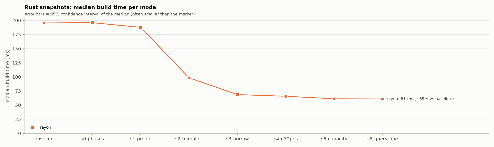
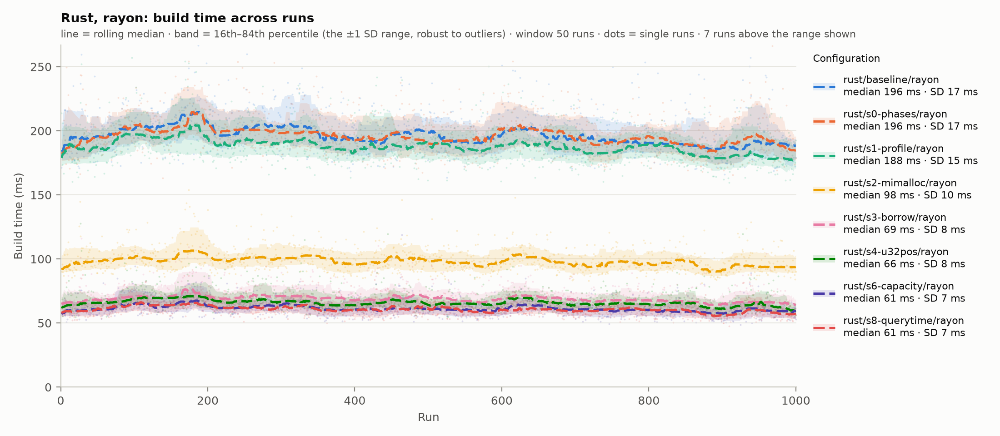
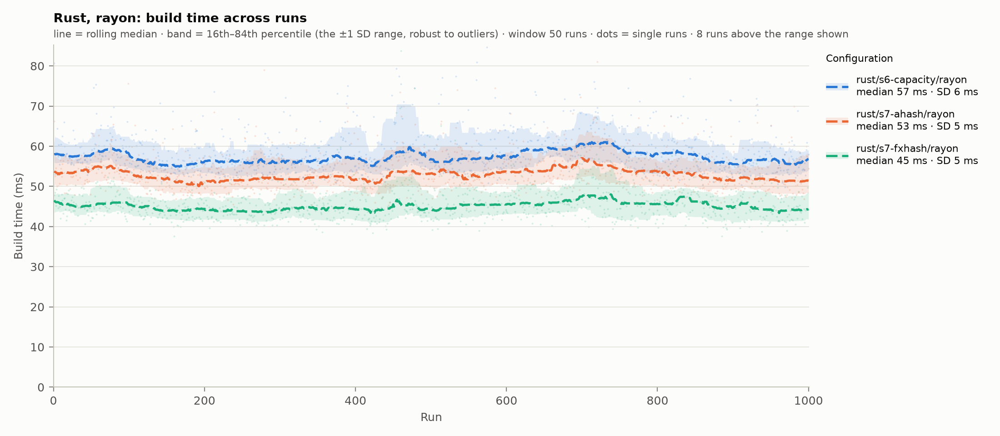
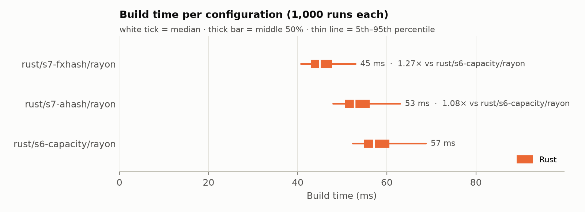
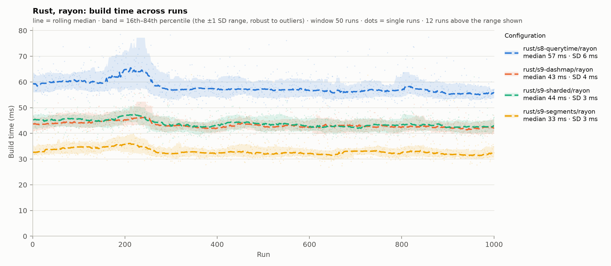
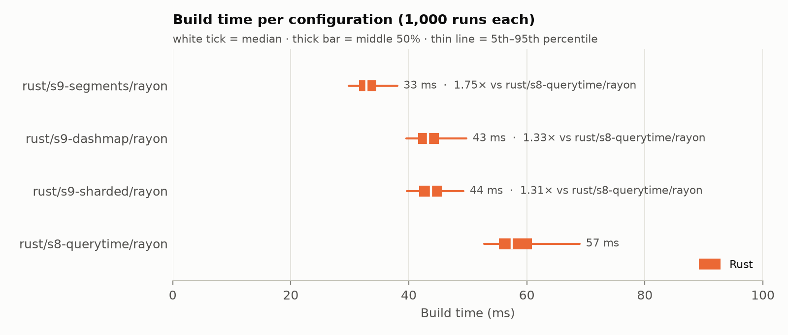
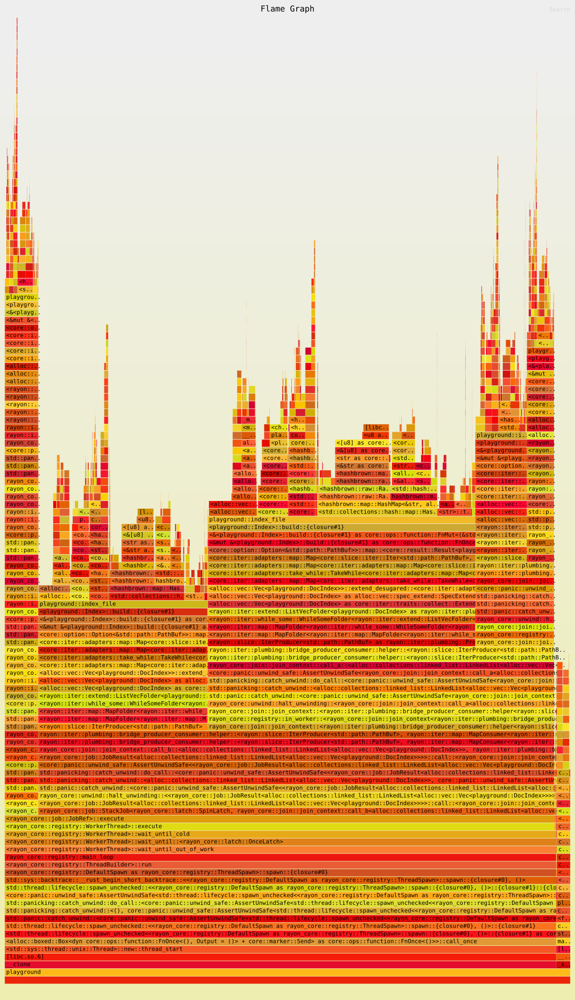
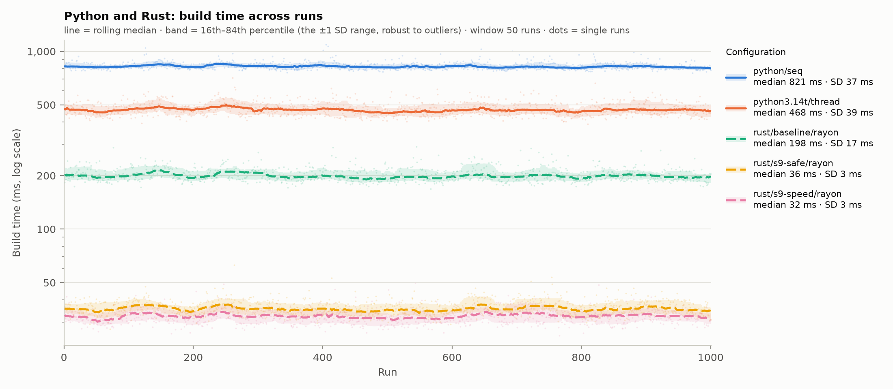
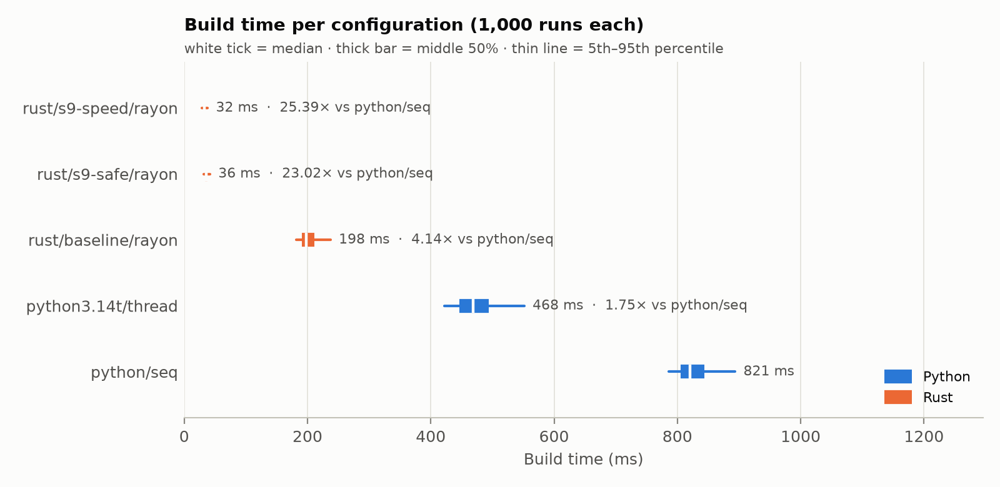

# rust-playground

A sandbox for learning Rust. Everything builds and runs inside a dev container, so no Rust
toolchain is installed on the Windows host. Code is edited in PyCharm Professional, with the Rust
plugin, connected to the container as a remote backend.

## What's here

| Path | What it is |
|---|---|
| `src/main.rs` | The current exercise: a small BM25 search engine over a folder of `.txt` files |
| `Cargo.toml` | The crate, `playground`. Dependencies: `rayon` (parallel indexing) and `mimalloc` (memory allocator). The release profile uses fat LTO and one codegen unit |
| `.cargo/config.toml` | Builds for this machine's CPU (`target-cpu=native`) |
| `bench/` | Benchmarks: Python against Rust, and the Rust tuning series. See [Benchmarks](#benchmarks) |
| `rust-toolchain.toml` | Pins Rust 1.99.0, with clippy and rustfmt |
| `.devcontainer/` | The container: `Dockerfile` and `devcontainer.json` |
| `data/` | Sample texts for the search exercise. Not committed; see [Sample data](#sample-data) |

## The container

- **Image:** `rust:1.99-slim-trixie` (Debian 13), plus git, gdb and the libraries the JetBrains
  backend needs.
- **User:** `dev`, not root.
- **Build output and downloaded crates** live in two named Docker volumes:
  - `rust-playground-target`, at `/home/dev/target` (set by `CARGO_TARGET_DIR`);
  - `rust-playground-registry`, at `/usr/local/cargo/registry`.

  Builds stay fast, they survive a container rebuild, and nothing compiled lands in the Windows
  folder.
- **Sources** are mounted from Windows at `/IdeaProjects/rust-playground`. The container and
  Windows see the same files, so git works from Windows with the container off.

To change the Rust version, change it in both the `Dockerfile` and `rust-toolchain.toml`.

## Getting started

You need Docker Desktop running, and PyCharm Professional with the Rust plugin.

**First time:**

1. Open `.devcontainer/devcontainer.json` in PyCharm.
2. Click the container icon in the gutter and choose **Create Dev Container and Mount Sources**.
3. When asked, choose the PyCharm 2026.2 backend.

**After that:** go to **File → Remote Development → Dev Containers**, pick `rust-playground` and
connect.

The terminal in the remote IDE is a shell inside the container. Check it with:

```bash
cargo --version
```

## Sample data

`data/` is in `.gitignore`. To recreate it, run this in the container terminal:

```bash
mkdir -p data
curl -L -o data/pride.txt        https://www.gutenberg.org/cache/epub/1342/pg1342.txt
curl -L -o data/moby.txt         https://www.gutenberg.org/cache/epub/2701/pg2701.txt
curl -L -o data/frankenstein.txt https://www.gutenberg.org/cache/epub/84/pg84.txt
```

Any folder of `.txt` files works.

## Running

```bash
cargo run -- data whale harpoon             # search data/ for "whale harpoon"
cargo run --release -- data whale harpoon   # optimized build, for timing
cargo test
cargo clippy
cargo fmt
```

The program prints how many documents and distinct words it indexed, then the top five files
with their BM25 scores.

## Exercise 1: BM25 search

`src/main.rs` has three parts:

- **`tokenize`** splits text on anything that isn't a letter or digit, and lowercases it.
- **`Index::build`** reads every `.txt` file in a folder into an inverted index: word → (document
  → count), plus each document's length in words.
- **`Index::search`** scores documents with BM25 (k1 = 1.2, b = 0.75) and returns them best first.

The Rust ideas it touches:

- **Borrowing.** `search` returns file names as `&str` borrowed from the index rather than copies,
  and the compiler ties their lifetime to `&self`.
- **Errors as values.** `std::io::Result` and `?` in `build` and `main`.
- **The `HashMap` entry API.** `entry(..).or_default()` and `or_insert(0)` count words without
  looking each one up twice.
- **Iterator chains** in `tokenize`.
- **`let ... else`** skips query words that aren't in the index.
- **`f64::total_cmp`** sorts the scores, because floats don't implement `Ord`.
- **Unit tests** in a `#[cfg(test)]` module.

## Benchmarks

`bench/` measures how long `Index::build` takes, so every change is judged by numbers rather than
impressions.

| File | What it does |
|---|---|
| `bench/run_bench.py` | Runs experiments: snapshots of Rust builds, the Python configurations, interleaved timed runs, output checks. Writes each experiment to `bench/results/` |
| `bench/analyze.py` | Summary tables and charts for one results file |
| `bench/index_bench.py` | The same index build in Python |
| `bench/results/` | Per experiment: a `.feather` file (one row per run), a `.json` file (machine, toolchains, corpus, settings) and a folder of tables and charts |

**Method (every series):**

- **Runs:** 5 warm-up rounds, then 1,000 measured rounds. Each round runs every configuration once,
  in a freshly shuffled order (the seed is recorded), so drift and background load land on all of
  them equally.
- **Main measure:** build time from the program's own timer, excluding process start-up. Also
  recorded: wall time, CPU time of the whole process tree, threads, and peak memory.
- **Search time (opt-in, `--query-bench`):** each Rust run also times a fixed set of 9 searches
  (6 BM25 queries, 3 phrases): one warm-up pass, then 50 timed passes. Reported as the median,
  across runs, of the average time per search. Off by default, because the searches add to each
  run's wall and CPU time.
- **Correctness:** before timing, every configuration writes its whole index in a fixed text form,
  and the dumps must be byte-identical or the run stops. Every run's document and word counts are
  checked too.
- **Statistics:** medians, with 95% bootstrap confidence intervals.
- **Corpus:** 21 Project Gutenberg books, 13.4 MB, 2,385,737 words, 37,238 distinct, copied to the
  container's own disk.
- **Machine:** AMD Ryzen 9 5900X (12 cores, 24 threads), 32 GB, Docker Desktop on WSL2.

**Running** (in the container; its image includes uv and Python 3.14 and 3.14t):

```bash
uv run --python 3.14 bench/run_bench.py snapshot <label> --note "what changed"   # build Rust, keep a copy
uv run --python 3.14 bench/run_bench.py snapshot <label> --features ahash --note "..."   # build with Cargo features
uv run --python 3.14 bench/run_bench.py run --rust baseline --extra-python 3.14t --runs 1000 --name languages
uv run --python 3.14 bench/run_bench.py run --no-python --rust-modes rayon --rust baseline,s0-phases,s1-profile --runs 1000 --name s1-profile
uv run --python 3.14 bench/run_bench.py run --no-python --rust-modes rayon --rust s8-querytime,<new> --runs 1000 --query-bench --name <new>   # also time searches
uv run --python 3.14 bench/analyze.py   # newest results file
```

### Series 1: Python against Rust

Experiment `20261003-003932_languages-v2`. The same algorithm in both languages: tokenize, index
each file on its own, merge. Python's thread and process modes use 24 workers, the same number
rayon uses.

| Configuration | Median build | vs Python sequential | Cores used |
|---|---|---|---|
| Python, sequential | 756.7 ms | 1.00× | 0.97 |
| Python, processes (24) | 421.7 ms | 1.79× | 3.04 |
| Python, threads (24, GIL on) | 857.9 ms | 0.88× | 0.98 |
| Python 3.14t, threads (24, free-threaded) | 428.8 ms | 1.76× | 1.79 |
| Rust, 1 thread | 331.6 ms | 2.28× | 0.99 |
| Rust, rayon (24) | 170.9 ms | 4.43× | 2.93 |

- **Rust with rayon is fastest:** 4.4× Python sequential, and 2.5× Python's best parallel option.
- **The GIL makes threads slower than no threads** (0.88×). Free-threaded 3.14t removes that and
  roughly matches processes, without copying results between processes.
- **No configuration uses its 24 workers well** (at most 3 cores busy on average). The single-threaded
  merge and the 21-file corpus limit parallel gains; the tuning series below finds a further cause.
- Peak memory isn't shown: this run predates the fix that stopped the runner's own memory from
  being counted.


### Series 2: Rust tuning

Rust with rayon is the baseline. Each step is one snapshot, built on all the steps before it, and
each experiment re-runs every earlier step alongside the new one, so the latest experiment holds
the whole series measured together. A step that makes the build slower is reverted: it moves to
[Tried and reverted](#tried-and-reverted) with its results, and the next step builds on the one
before it. A step that compares alternatives gets its own, smaller experiment and its own table
(see [Step 7](#step-7-hash-functions) and [Step 9](#step-9-the-merge)).

The table and charts come from the latest full-series experiment, `20261004-182003_s8-querytime`.
Timings drift between experiments (this run's baseline: 195.5 ms; the one before: 189.1 ms), so
compare steps within one experiment, not across experiments.

| Step | Snapshot | Change | Median build | vs previous step (95% CI) | Per-file indexing | Merge | Cores used | CPU time | Peak memory |
|---|---|---|---|---|---|---|---|---|---|
| — | `baseline` | Rust with rayon | 195.5 ms | — | — | — | 2.83 | 698 ms | 142 MB |
| 0 | `s0-phases` | Phase timers and index dump (control) | 196.0 ms | +0.3% (−0.7% to +1.2%) | 115.3 ms | 79.8 ms | 2.82 | 696 ms | 142 MB |
| 1 | `s1-profile` | Fat LTO, one codegen unit, `target-cpu=native` | 187.6 ms | −4.3% (−5.1% to −3.4%) | 113.5 ms | 73.6 ms | 2.82 | 675 ms | 142 MB |
| 2 | `s2-mimalloc` | mimalloc allocator | 98.2 ms | −47.6% (−48.1% to −47.2%) | 60.3 ms | 37.2 ms | 8.52 | 957 ms | 291 MB |
| 3 | `s3-borrow` | `&str` slices, lowercase each file once | 68.6 ms | −30.2% (−30.7% to −29.4%) | 41.4 ms | 27.0 ms | 7.49 | 612 ms | 217 MB |
| 4 | `s4-u32pos` | u32 positions | 65.7 ms | −4.3% (−5.2% to −3.4%) | 37.3 ms | 28.0 ms | 7.32 | 568 ms | 213 MB |
| 6 | `s6-capacity` | `with_capacity` for each file's word map, the merged map and the document lists | 61.2 ms | −6.8% (−7.9% to −5.9%) | 33.4 ms | 27.7 ms | 6.59 | 475 ms | 139 MB |
| 8 | `s8-querytime` | Search timing (`QUERY_BENCH`), measurement only (control) | 60.8 ms | −0.6% (−1.6% to +0.4%) | 33.3 ms | 27.2 ms | 6.52 | 479 ms* | 139 MB |

\* Includes the timed searches, which only step 8 runs; see below. Median search time: 3.76 µs per
search (3.74 to 3.77).

By step 8: **3.2× faster than the baseline** (−69%) with the default hasher. Step 9's segments
build another 43% faster than step 8, measured in their own experiment. The
[overview](#overview-python-against-the-end-of-series-2) measures where the series ended: 5.6× faster
than the baseline with the default hasher, 6.1× with FxHash (step 7's option, for text you trust).

- **The control matches the baseline** (the interval includes zero), so the timers cost nothing and
  the setup measures reliably.
- **Allocation was the hidden bottleneck.** With the default allocator, rayon's threads mostly
  queued for memory; mimalloc's per-thread pools nearly halved the build and tripled the cores in
  use. The costs: CPU time rose by 42% (more cores working at once, for half the wall time), and
  peak memory roughly doubled (142 to 291 MB), because mimalloc keeps freed memory for reuse.
- **Allocating less still paid off after mimalloc.** Slices instead of one `String` per word cut
  per-file indexing by 31%, CPU time by 36%, and peak memory by a quarter (291 to 217 MB). The merge
  also got faster, likely because the per-file maps now hold compactly allocated keys.
- **u32 positions: a small, real gain** (−4.3%), all of it in per-file indexing (−10%; the merge
  didn't improve). Total CPU time fell another 7%. Peak memory fell only 4 MB of a possible ~10 MB,
  since mimalloc holds on to freed memory.
- **Pre-sizing saved more memory than time.** The build got 6.8% faster, all in per-file indexing
  (−10%); CPU time fell 16%. Peak memory fell by a third (213 to 139 MB), below the baseline's,
  likely because each map is now allocated once: a map that grows allocates a bigger table and frees
  the old one, and mimalloc kept every outgrown table. Pre-sizing the merged map didn't speed up the
  merge, so its cost lies in the per-pair work rather than in the map growing.
- **Timing searches costs the build nothing.** Step 8 adds code that runs only when `QUERY_BENCH` is
  set, and builds as fast as step 6 (the interval includes zero), with both phases unchanged.
- **The search baseline: 3.76 µs per search** (95% CI 3.74 to 3.77), averaged over the 9 searches.
  This is the number the merge alternatives below are measured against.
- **Only step 8 runs the searches,** so its wall time (73.2 against 71.8 ms) and CPU time include
  about 1.7 ms of searching (51 passes of 9 searches). Compare wall and CPU time only between runs
  with the same `--query-bench` setting.
- **The merge is still the largest single-threaded piece** (about 27 of 61 ms).




#### Step 7: hash functions

Every map hashes its keys. Rust's default, SipHash, gives each map a random secret key, so nobody
can craft words that all land in the same slot and slow the map to a crawl (a HashDoS attack). Step
7 measured two faster hashers against it, in a separate experiment, `20261004-174947_s7-hashers`,
with three configurations: step 6 itself (SipHash), and the same code built with each alternative.

| Hasher | Snapshot | Protection against crafted keys | Median build | vs SipHash (95% CI) | Per-file indexing | Merge | Cores used | CPU time | Peak memory |
|---|---|---|---|---|---|---|---|---|---|
| SipHash (std default) | `s6-capacity` | Strongest: a keyed hash designed for this | 57.1 ms | — | 32.5 ms | 24.6 ms | 6.88 | 463 ms | 139 MB |
| aHash | `s7-ahash` | Random key per map; claims DoS resistance, not cryptographic | 52.8 ms | −7.6% (−8.4% to −6.8%) | 30.8 ms | 21.9 ms | 7.08 | 444 ms | 141 MB |
| FxHash (`rustc-hash`) | `s7-fxhash` | None: no seed, so collisions can be worked out in advance | 45.0 ms | −21.3% (−22.0% to −20.7%) | 29.6 ms | 15.2 ms | 7.83 | 427 ms | 137 MB |

- **FxHash is the fastest by far** (−21%), and most of the gain is in the merge (−38%). The merge
  hashes 165,216 `String` keys and inserts document numbers into 37,238 small per-word maps, each
  created with its own hasher. Fx hashes a number with one multiply and needs no setup per map;
  SipHash and aHash do more rounds per key and set up a random key for every map.
- **aHash recovers about a third of that** (−7.6%), while keeping a random key per map.
- **Per-file indexing changed least** (−5% and −9%). Each file runs on its own thread, so this phase
  takes as long as the largest book, and reading, lowercasing and splitting that book cost the same
  under any hasher.
- **Memory didn't change** beyond a couple of MB.

**How the code uses this:** the hasher is picked at build time, and the default build stays on
SipHash. FxHash fits offline builds over text you trust; the default, or aHash, fits anything that
indexes text other people wrote.

```bash
cargo build --release                         # SipHash
cargo build --release --features ahash        # aHash
cargo build --release --features rustc-hash   # FxHash
```




#### Step 9: the merge

After step 8, the merge was the largest single-threaded phase. Step 9 measured three alternatives
in one experiment, `20261004-193448_s9-merge`, against step 8 itself. Each alternative is step 8
plus one change. All four ran with `--query-bench`, because the alternatives trade build time
against search time.

| Alternative | Snapshot | How it works | Median build | vs step 8 (95% CI) | Per-file indexing | Merge | Search | vs step 8 (95% CI) | CPU time | Peak memory |
|---|---|---|---|---|---|---|---|---|---|---|
| One thread merges (step 8) | `s8-querytime` | Every file's words go into one map, one file after another | 57.4 ms | — | 33.0 ms | 24.4 ms | 3.74 µs | — | 472 ms | 139 MB |
| dashmap | `s9-dashmap` | One shared map (the `dashmap` crate) that all files insert into at once; a lock per shard of the map | 43.3 ms | −24.6% (−25.2% to −24.1%) | 32.7 ms | 10.4 ms | 3.76 µs | +0.6% (+0.1% to +1.1%) | 537 ms | 141 MB |
| Sharded | `s9-sharded` | Words split into 32 shards by hash; one task per shard merges that shard from every file; no locks | 43.8 ms | −23.8% (−24.4% to −23.3%) | 32.7 ms | 10.7 ms | 3.95 µs | +5.6% (+5.0% to +6.1%) | 595 ms | 171 MB |
| **Segments (adopted)** | `s9-segments` | No merge: each file's index is kept as a segment, and searches ask every segment | 32.8 ms | −42.8% (−43.3% to −42.4%) | 32.7 ms | — | 4.33 µs | +16.0% (+15.5% to +16.7%) | 451 ms | 135 MB |

CPU time and peak memory include the timed searches, which all four configurations ran. Code:
commits `6d0fb95` (dashmap) and `76ec7ff` (sharded), each reverted in the commit after it, and
`92fbb79` (segments), reverted for the experiment and applied again afterwards.

- **Both parallel merges cut the merge to the same ~10.5 ms**, 2.3× faster rather than anything near
  24×. Likely cause: the largest book again. dashmap inserts file by file, and sharded's first pass
  splits words file by file, so neither finishes before the biggest file's work does.
- **dashmap edged out sharded, although sharded takes no locks.** With 21 writers spread over about
  128 shards, dashmap's locks were rarely contested. Sharded hashes every word twice (once to pick
  its shard, once in the shard's own map), first moves all 165,216 (word, positions) pairs into
  buckets, and used 26% more CPU time than step 8 (dashmap: 14%) and 32 MB more memory. The double
  hash also slows its searches.
- **Segments build fastest because they skip the merge** (−43%). Searches cost 0.59 µs more (+16%):
  each search word is looked up in all 21 segments instead of once, which is a small part of a
  search's time. That cost grows with the number of segments, which is why Lucene and tantivy merge
  small segments into larger ones in the background.
- **Why segments:** they save 24.6 ms per build against step 8, and 10.4 ms against dashmap, for
  0.6 µs per search; against dashmap they break even at about 18,000 searches per build. They're
  also tantivy's design, so Series 3 compares implementations rather than designs. `s9-dashmap`
  stays in those comparisons as the merged-index reference.
- **Counting distinct words now takes a merged pass** over every segment's words. The program
  counts them after the build timer stops: the count is a correctness check, not part of building.
- **Per-file indexing is now the whole build** (about 33 ms), so that's what the [flamegraph](#profile-where-the-build-spends-its-time) profiles.




#### Profile: where the build spends its time

A flamegraph of `s9-segments`. A sampling profiler (`perf`) records, about 1,000 times a second,
which function each thread is running and the chain of calls that led there. Each box is a
function; its width is its share of the samples, and the boxes above it are the functions it called.



The image on this page is static; open the SVG file itself in a browser to click into a frame or
search for a function.

**How it was made:** one build takes about 30 ms, too short to sample well, so the `BUILD_REPS`
variable makes the program build the index that many extra times before the timed build. 30 extra
builds gave 11,035 samples; another 190 (1.7%) were lost because perf couldn't write them out in
time. The release build gets debug info, so functions that LTO inlined into their callers still
get boxes of their own.

```bash
mkdir -p ~/prof && cd ~/prof   # perf.data can't be written in the Windows-shared repo folder ("Bad address")
CARGO_PROFILE_RELEASE_DEBUG=true BUILD_REPS=30 cargo flamegraph \
  -c "record -F 997 --call-graph dwarf,32768 -g" \
  --manifest-path /IdeaProjects/rust-playground/Cargo.toml \
  -o /IdeaProjects/rust-playground/data/flamegraph.svg -- ~/bench-data whale
```

`dwarf,32768` copies 32 KB of each thread's stack per sample. `cargo flamegraph`'s default, 64 KB,
lost 20% of the samples and wrote 545 MB; its breakdown matched this one within about a point.

| Code in `index_file` | Share of CPU time | Inside it |
|---|---|---|
| `local.entry(word)`: find the word in the file's map, or add it | 44% | probing the map and comparing words 25%, hashing them (SipHash) 18% |
| `.push(pos)`: append the position to the word's `Vec<u32>` | 17% | about half writing, half growing the `Vec` (mimalloc) |
| `to_lowercase()` on the whole book | 12% | |
| `words(&text)` and the loop around it: splitting the text into words | about 12% | |
| Turning the keys into `String`s (the `postings` map) | 10% | hashing every word again for the new map 4%, allocating 2% |
| `fs::read_to_string` | 1% | the user-space part only: checking that the text is valid UTF-8 |
| Outside `index_file`: freeing each repetition's index, rayon | 3% | |

Shares are inclusive (a function plus everything it calls), measured from the SVG's frame widths.

- **About half the CPU time is one line,** `local.entry(word)`. Hashing is 18%; probing and comparing
  is 25%. A matching hash only narrows the search, so the map compares the actual bytes, and the
  keys are `&str` slices pointing back into the book's text: each comparison likely reads memory
  scattered over the whole book (a cache miss).
- **Hashing is about a fifth of the CPU time** (18% in lookups, 4% building the `String` map), which
  fits step 7, where FxHash took 9% off per-file indexing. The `write_u8` frames are part of how a
  `str` hashes: its bytes, then a `0xff` byte, so ("ab", "c") and ("a", "bc") don't feed the hasher
  the same bytes.
- **Growing the position lists costs as much as filling them.** Each word's `Vec<u32>` starts empty
  and doubles as it fills; step 6 pre-sized the maps, not these lists.
- **Allocation is no longer the bottleneck it was before step 2:** mimalloc is about 13% of the CPU
  time, and about 7% without the repetitions' freeing (see below).
- **Turning keys into `String`s costs 10%.** It's what lets each segment own its words instead of
  borrowing the book's text.
- **Reading the files barely shows,** but only its user-space part is visible.

**Limits:**

- **CPU time, not wall time.** The shares add up the time of all threads. Wall time is set by the
  slowest thread, likely the one indexing the largest book, moby.txt (1.28 MB), and a profile
  can't show that. A timer per file would.
- **User space only.** The container may only profile its own code (`perf_event_paranoid` = 2), so
  kernel work, such as reading the files and mapping fresh memory, doesn't appear.
- **The repetitions add about 6%.** Each extra build's index is freed on the main thread, so
  mimalloc has to hand that memory back to the worker threads that allocated it
  (`mi_free_block_mt`, `mi_page_thread_collect_to_local`). A single build doesn't do this before its
  timer stops.

#### Tried and reverted

Each measured against the step before it, in its own experiment.

| Step | Snapshot | Change | Median build | vs step 4 (95% CI) | Per-file indexing | Merge | CPU time | Peak memory | Experiment | Code |
|---|---|---|---|---|---|---|---|---|---|---|
| 5 | `s5-wordids` | u32 word IDs: each word maps to a number, and postings live in a `Vec` indexed by it | 69.3 ms | +2.5% (+1.3% to +3.6%) | 37.9 ms | 31.0 ms | 579 ms | 213 MB | `20261004-163351_s5-wordids` | commit `f1f58e6`, reverted in the commit after it |

- **u32 word IDs made the build slower** (+2.5%). Per-file indexing didn't change; the merge took
  1.3 ms longer. The IDs removed no work: the merge still hashes every word as a `String`, then
  takes an extra jump to `postings[id]` to reach the word's map. That's probably a cache miss for
  each of the ~165,000 (word, document) pairs, about 8 ns apiece. IDs pay off where a `u32` replaces
  a string inside a busy loop, and nothing here does that yet.
- **The tokenizer fix stays.** It's a separate, earlier commit (`40f4c43`): indexing and queries now
  share one definition of a word. It changes only how queries are split, so the build is unaffected.


#### Overview: Python against the end of Series 2

Experiment `20261004-233633_overview`. One run with five configurations: sequential Python, free-threaded
Python 3.14t with 24 threads, the Rust baseline, and the current code (step 9, segments) with each hasher.
`s9-safe` uses the default SipHash and `s9-speed` FxHash (`--features rustc-hash`); both are built from
the same commit (`5abcea3`), so the hasher is the only difference.

| Configuration | Median build (95% CI) | vs Python sequential | Cores used | CPU time | Peak memory |
|---|---|---|---|---|---|
| Python, sequential | 820.7 ms (818.6 to 822.9) | 1.00× | 0.97 | 1,413 ms | 162 MB |
| Python 3.14t, threads (24, free-threaded) | 468.5 ms (466.3 to 471.1) | 1.75× | 1.80 | 2,119 ms | 371 MB |
| Rust baseline, rayon | 198.2 ms (197.1 to 199.0) | 4.14× | 2.82 | 708 ms | 141 MB |
| Rust step 9, SipHash (`s9-safe`) | 35.7 ms (35.4 to 35.8) | 23.0× | 9.32 | 487 ms | 135 MB |
| Rust step 9, FxHash (`s9-speed`) | 32.3 ms (32.1 to 32.5) | 25.4× | 9.49 | 455 ms | 131 MB |

- **Series 2 made the Rust build 6.1× faster** (198.2 to 32.3 ms; 5.6× with the default hasher). Rust
  is now 25× faster than sequential Python and 14.5× faster than free-threaded Python.
- **FxHash is now worth 9.3%** (−10.0% to −8.5%) over SipHash, down from 21% in step 7. Most of step 7's
  gain was in the merge, and segments removed the merge. The trade is unchanged: FxHash for text you
  trust, SipHash when inputs could be crafted to collide.
- **Rust does less work, not only more of it at once.** It spends 455 ms of CPU where sequential
  Python spends 1,413 ms, about a third. Free-threaded Python gets its 1.75× by spending 50% more CPU
  than sequential Python, and uses 2.3× the memory.
- **The tuned build uses less memory than the baseline** (131 to 135 MB against 141 MB), even with
  mimalloc holding freed memory for reuse.
- **About 9.5 of 24 cores are busy.** That figure counts start-up and exit (about 15 ms of the 48 ms
  wall time), so more are busy during the build itself. Still, 21 books on 24 threads cap the
  parallelism, and the largest book (`moby.txt`, 1.28 MB of 13.4 MB) likely decides when the build
  ends. A timer per file would show it.
- **Rust's spread looks larger** (9.5% coefficient of variation against Python's 4.5%) only because a
  few milliseconds of scheduling jitter is a bigger share of 32 ms. The medians are still pinned down
  to ±0.2 ms.
- **Compare within this run.** Both Python configurations ran 8 to 9% slower than in Series 1 (756.7
  to 820.7 ms; 428.8 to 468.5 ms), while the Rust baseline stayed within 2% of the Series 2 runs
  (195.5 to 198.2 ms).

Both charts use a log scale, so equal distances are equal ratios.




**Series 2 is complete.** Step 9 was measured against step 8 in its own experiment, and the overview
measures the end result against the baseline and Python in one run, so a re-run of every step
together was dropped as adding little.

Next, Series 3: this engine against tantivy, a Rust search library built on segments, with
`s9-dashmap` as the merged-index reference.

## Committing and pushing

Either way works.

- **From Windows,** with the container on or off: open PowerShell in the repo folder and use
  `git add`, `git commit` and `git push` as usual.
- **From the remote IDE:** git inside the container refuses the mounted repo with "detected
  dubious ownership", because the files belong to a different user than `dev`. Fix it once in
  the container terminal:

  ```bash
  git config --global --add safe.directory /IdeaProjects/rust-playground
  git config --global user.name "Your Name"
  git config --global user.email "you@example.com"
  ```

  These settings live in the container, so a rebuild erases them. Pushing from the container
  also needs GitHub credentials there. Pushing from Windows doesn't.

## Troubleshooting

- **"detected dubious ownership"** in the commit window: see [Committing and
  pushing](#committing-and-pushing).
- **Connecting fails while the JetBrains Client downloads:** reconnect from **File → Remote
  Development → Dev Containers** and choose the backend that's already in the container.

## Ideas for next exercises

- Command-line options with `clap`: number of results, folder, case folding on or off.
- Index files in parallel with `rayon`, and compare timings.
- Save the index to disk and load it instead of rebuilding it each run.
- Phrase queries, using word positions in the index.
- The same search with `tantivy`, a full-text search library written in Rust.
- Time it against the same algorithm in Python.
